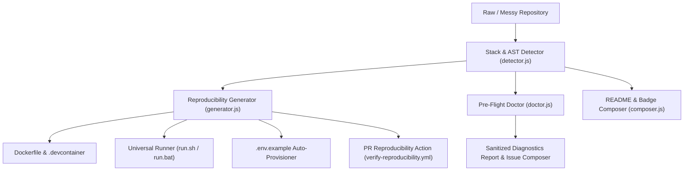
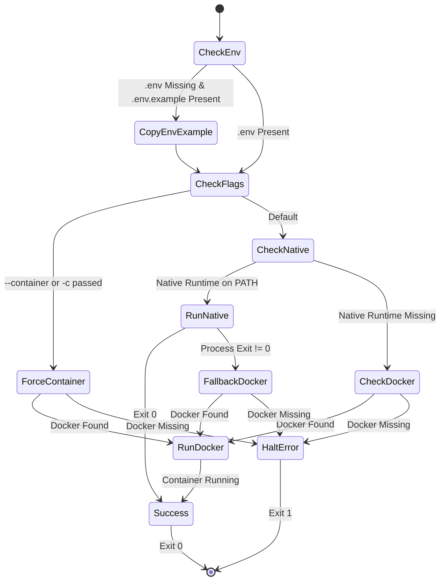

# System Architecture & Technical Specifications

**Project**: `runrepo`  
**Repository**: [`https://github.com/Terrox0/runrepo`](https://github.com/Terrox0/runrepo)  
**Version**: `0.1.0`

---

## 1. High-Level System Architecture

`runrepo` is structured around five decoupled stages:

---

## 2. Component Breakdown

### 2.1 The Stack & AST Detector (`src/detector.js`)
- Performs lightweight, synchronous inspection of filesystem trees without spawning child processes.
- Scans up to 3 directory levels deep, filtering out `node_modules`, `.git`, `vendor`, and `.venv`.
- Implements AST/Regex scanners for environment variables across JavaScript, TypeScript, Python, Go, and Rust.
- Extracts project metadata, package managers, custom scripts, and bound ports.

### 2.2 The Environment Synthesizer (`src/generator.js`)
- Generates hermetic, multi-stage, or lightweight developer Dockerfiles.
- Produces `.devcontainer/devcontainer.json` compatible with GitHub Codespaces, VS Code Remote Containers, and JetBrains.
- Generates universal `./run.sh` and `./run.bat` scripts implementing the dual-tier run architecture (native fast-path with container fallback).
- Auto-provisions `.env.example` templates populated with extracted variable names and sensible defaults.
- Generates GitHub Action workflows validating container reproducibility on incoming PRs.

### 2.3 The Pre-Flight Doctor (`src/doctor.js`)
- Audits local system and repository readiness before launch:
  1. Detects host runtime versions.
  2. Detects container engine (Docker / Podman) status.
  3. Verifies reproducibility artifacts (`run.sh`, `Dockerfile`).
  4. Cross-references source-code environment variables against `.env` and `.env.example`.
- Outputs clean ANSI terminal summaries, structured JSON for CI (`--json`), or sanitized Markdown for GitHub issues (`--issue`).

### 2.4 The Automated README Composer (`src/composer.js`)
- Injects a verified `[![runrepo: 1-command]](#quickstart)` badge.
- Generates or updates the `## 🚀 Quickstart (1-Command Run)` section between boundary markers `<!-- runrepo:start -->` and `<!-- runrepo:end -->`.
- Documents detected ports, default run commands, and auto-generated environment variable tables.

---

## 3. Dual-Tier Execution State Machine

